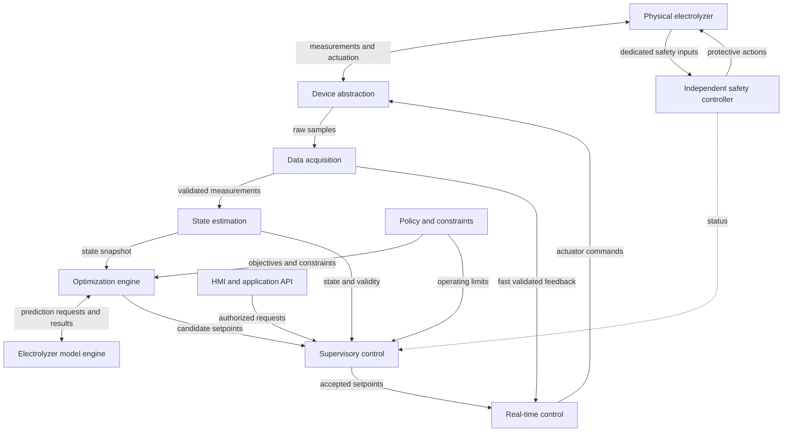
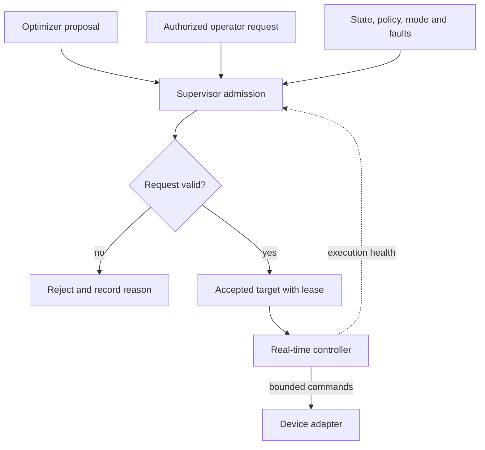
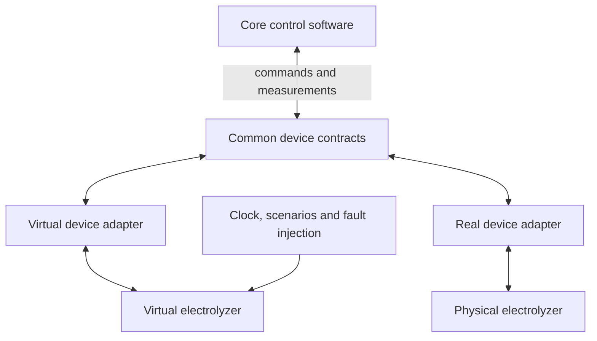

# Faradix Architecture — Version 0.1

| Field | Value |
| --- | --- |
| Product | Faradix Electrolyzer Control & Optimization Platform |
| Document version | 0.1 |
| Status | Proposed architecture; documentation baseline |
| Prepared | 2026-10-27 |
| Implementation status | No implementation is delivered by this documentation baseline |
| Basis | Supplied Faradix architecture context and the previously reviewed module-design draft |

This is a self-contained repository document. It preserves the supplied architectural principles and distinguishes them from proposed internal designs and unresolved engineering choices. Version 0.1 identifies this document, not a software release or a finalized industrial design.

See [README.md](README.md) for the project introduction and current repository scope.

## 1. Scope and product context

Faradix is developing a water electrolyzer for hydrogen production. The intended software will continuously observe the plant, estimate its state, predict its behavior, apply operating policies, propose operating targets, and control the equipment.

The final sensor inventory, actuator inventory, I/O topology, communication protocols, physical equations, operating envelope, safety functions, and timing requirements are not yet known. Examples in this document are design concepts rather than finalized hardware specifications.

| Horizon | Scope |
| --- | --- |
| Current work | Write and review `README.md` and `ARCHITECTURE_v0.1.md` only. |
| First planned implementation | Demonstrate an end-to-end closed loop against a virtual electrolyzer. |
| Subsequent engineering | Integrate validated models, real device adapters, measured timing requirements, and hardware-specific operating procedures. |
| Future capabilities | Advanced optimization, calibration workflows, richer HMI, external integration, digital-twin interoperability, and optional ML assistance. |

Code scaffolding, dependency installation, build systems, CI/CD, containers, cloud deployment, and real hardware operation are outside the current documentation milestone. Future capabilities listed here are not commitments to implement them immediately.

## 2. Architectural baseline

The following principles are retained from the project context:

1. **Independent hard safety.** Critical protective functions must be designed to remain effective despite failures of the main application, optimizer, model, operating system, network, database, HMI, or cloud connection.
2. **Explicit command authority.** The optimizer proposes setpoints. Supervisory control decides whether they may be applied. Low-level control produces actuator commands. Operator and external requests follow the same supervisory admission path.
3. **Separate scientific and operational responsibilities.** The model predicts behavior; policy specifies objectives and operating constraints; optimization selects a proposal; control executes accepted targets.
4. **Separate measurement from estimation.** DAQ reports validated observations and their quality. State estimation produces the best available estimate and its validity.
5. **Stable hardware interfaces.** Vendor-specific behavior belongs in adapters. Simulated and real devices expose compatible domain contracts.
6. **Independent execution rates.** Time-sensitive control does not wait for an optimizer, UI, database, or remote service to respond.
7. **Simple initial deployment.** Start with a modular core. A logical module does not automatically require a separate process or microservice.
8. **Traceable decisions.** Important commands, state transitions, model versions, policy versions, and configuration changes should be attributable to their inputs and context.

These principles define the architecture's intended behavior. This document does not establish that any hardware, operating system, controller, or implementation already satisfies them.

## 3. Logical system architecture

The model and policy are collaborators in decision-making, not mandatory sequential stages through which every sensor sample must pass. The fast feedback path supplies the measurements required by low-level control independently of slower estimation and optimization work.

Supporting modules provide data history, diagnostics, configuration, calibration, application access, and optional external integration. They are described below; their arrows are omitted here to keep the control relationships readable.

For software-only development, a virtual electrolyzer replaces the physical plant behind the device interface. A simulated safety model can exercise software scenarios; it is distinct from the independent safety hardware required for the real plant.

## 4. Module responsibilities and internal structure

### 4.1 Device abstraction layer

**Responsibility:** isolate vendor protocols, channel addressing, and device capabilities from the core.

**Proposed internals:** device registry, channel mapping, backend selection, protocol adapters, read/decode path, command validation/encoding, and device status reporting.

**Inputs and outputs:** receive raw device I/O and `ControlCommand` requests; emit sample envelopes, communication status, dispatch results, and readback when supported.

Timeouts and communication errors must remain explicit. Successful transmission is not proof that an actuator physically reached its requested state. Independent safety actions do not pass through this application abstraction.

### 4.2 Data acquisition

**Responsibility:** turn incoming samples into usable measurements with units, time, identity, and quality.

**Proposed internals:** acquisition scheduling, timestamp/sequence handling, unit normalization, signal mapping, basic plausibility checks, freshness checks, and bounded feedback snapshots.

**Inputs and outputs:** raw sample envelopes become `Measurement` batches. Relevant validated signals feed real-time control; richer batches feed state estimation and asynchronous recording.

Missing, invalid, or stale values are marked accordingly. A previous value must not silently become a fresh valid measurement. Filtering must preserve the latency requirements of each consumer.

### 4.3 State estimation

**Responsibility:** estimate the plant state from imperfect measurements.

**Proposed internals:** bounded time alignment, input-quality gating, filtering, derived signals, optional observers, residual checks, and confidence assessment.

**Inputs and outputs:** measurements and approved estimator parameters produce a `SystemState` snapshot with provenance and validity. Measured and estimated quantities remain distinguishable.

Insufficient observations produce an explicit degraded or invalid estimate. The supervisor, rather than the estimator, decides the operating response. Advanced estimators are optional future additions.

### 4.4 Electrolyzer model engine

**Responsibility:** predict behavior for a given state and candidate operating condition.

**Proposed internals:** request validation, a versioned parameter bundle, coupled model evaluation, and derived performance calculations. Potential submodels cover electrochemistry, electrical behavior, thermal behavior, fluids, gases, production, efficiency, and degradation.

**Inputs and outputs:** state, candidate conditions, and prediction horizon produce `Prediction` values with a model version and validity status.

Only available and validated submodels are enabled. Out-of-domain requests, unsupported outputs, or solver failures are reported explicitly. The model does not issue device commands or encode the operator's objectives.

### 4.5 Policy and constraints engine

**Responsibility:** express what operation is permitted and which objectives are preferred.

**Proposed internals:** mode rules, policy configuration, approved operating-envelope references, priority resolution, consistency checks, and hard/soft constraint classification.

**Inputs and outputs:** operating context and versioned policy produce an objective specification and `ConstraintSet` for the optimizer and supervisor.

Physical and mandatory operating limits cannot be traded away for a better objective. Soft constraints and preferences operate within the permitted envelope. Conflicting policies are rejected. Application policy configuration does not configure or disable independent hard safety.

### 4.6 Optimization engine

**Responsibility:** propose a desirable feasible operating point.

**Proposed internals:** periodic/event triggering, consistent input snapshots, a bounded solve job, a replaceable algorithm, calls to the model interface, feasibility checks, and result packaging.

**Inputs and outputs:** `SystemState`, objectives, constraints, and a fixed model version produce `OptimizationResult`: a candidate or failure status, input references, and an expiry.

Timeout, infeasibility, and invalid predictions are normal explicit outcomes. The optimizer never writes to actuators. Start with a simple rule-based or numerical approach; MPC and ML assistance remain later choices.

### 4.7 Supervisory control

**Responsibility:** own operational transitions and the admission of requested targets.

**Proposed internals:** command-source arbitration, lifecycle state machine, state/quality checks, setpoint freshness checks, constraint checks, rate limiting, handover handling, and approved fallback selection.

**Inputs and outputs:** optimizer proposals or authorized operator requests, together with state, policy, faults, and safety status, produce `AcceptedSetpoint` or a rejection with a reason.

Manual mode does not bypass restrictions. Clamping or shaping a proposal requires rechecking relevant coupled constraints. Holding the last target is permitted only when its validity and the operating procedure allow it.

### 4.8 Real-time control

**Responsibility:** drive the equipment toward the accepted target using bounded control work.

**Proposed internals:** feedback snapshots, a target mailbox, freshness/lease checks, controller algorithms, actuator output limits, anti-windup where applicable, command sequencing, and cycle-health monitoring.

**Inputs and outputs:** validated feedback and `AcceptedSetpoint` produce `ControlCommand` and execution status. PID, feed-forward, and other controllers are candidates, not universal requirements.

This path excludes blocking optimization, database access, remote API calls, and unbounded work. Expired targets, stale feedback, and missed deadlines invoke defined local behavior and notify the supervisor. Hardware-specific fallback actions remain to be designed.

### 4.9 Independent safety layer

**Responsibility:** enforce critical protective functions independently of the application.

**Conceptual structure:** safety inputs and emergency-stop/interlock signals feed independent safety logic, which controls protective outputs and final elements. Main software may observe status; ordinary commands must not defeat protective action.

The exact controller, sensor arrangement, trip conditions, reset conditions, safe states, failure coverage, and integrity requirements depend on the hardware safety design. HMI acknowledgement is distinct from safety reset and restart authorization.

This subsection defines a boundary. It is not a safety implementation, certification, or complete hazard analysis.

### 4.10 Virtual electrolyzer

**Responsibility:** support closed-loop software development before final hardware is available.

**Proposed internals:** simulation clock, scenario configuration, actuator dynamics, plant dynamics, sensor behavior, fault injection, and recording/replay.

**Inputs and outputs:** the same domain command and measurement contracts used by real adapters. Initial equations may be simple; simulated plant state and externally observed sensor values are separate.

The simulation plant and the optimizer's prediction model have different roles. Parameter mismatch, noise, delays, and failures must be testable. Simulated safety behavior is a test aid, not a substitute for independent real hardware protection.

### 4.11 Data management and logging

**Responsibility:** retain operational evidence for investigation, analysis, and model improvement.

**Proposed internals:** bounded asynchronous queues, background writers, event/measurement storage, version references, query/export, and retention policies.

Records include measurements, states, proposals, accepted targets, commands, alarms, and configuration changes. Decisions should reference the state, model, policy, and configuration that produced them.

Storage failure must not block the control cycle. Queue overflow policy and loss counters must be explicit. If an operating mode requires uninterrupted audit recording, the supervisory response to recording loss must be separately defined.

### 4.12 Diagnostics and fault management

**Responsibility:** turn software/device health evidence into actionable faults and alarms.

**Proposed internals:** diagnostic rules, persistence checks, severity classification, deduplication, alarm lifecycle management, and contextual event records.

Inputs include measurement quality, device status, timing health, and model residuals where available. Outputs go to the supervisor, HMI, and event history. Acknowledging an alarm does not clear its cause or reset a safety trip. General application diagnostics do not replace independent safety functions.

### 4.13 Configuration and versioning

**Responsibility:** validate and activate compatible configuration snapshots in a controlled manner.

**Proposed internals:** schema/unit/range validation, compatibility checks, version storage, staging, permitted activation boundaries, and change history.

Device maps, runtime settings, policies, and model parameters are configuration domains. Related versions must be coherent. A running solve uses a fixed input/version snapshot; the control cycle does not parse configuration files.

Invalid changes are rejected. Rollback also requires compatibility and operating-state checks. Independent safety configuration remains outside this general application workflow.

### 4.14 Model calibration

**Responsibility:** propose improved model parameters from experimental or operational evidence.

**Proposed internals:** data selection and quality checks, calibration/validation separation, offline fitting, model evaluation, validation reports, engineering review, and version registration.

The output is a candidate parameter/model bundle with a validity domain and supporting evidence. It reaches runtime only through the configuration activation workflow. Automatic online adaptation is a future capability with additional requirements.

### 4.15 HMI and application API

**Responsibility:** expose monitoring and authorized operational actions to users.

**Proposed internals:** live/trend/alarm views, API authorization, read/stream gateways, command admission into the supervisor, configuration requests, and request status tracking.

Reads use snapshots or history. Commands carry identity and request IDs; handling must define deduplication and distinguish received, accepted, rejected, and applied states. A request ID alone does not guarantee exactly-once execution.

UI/API loss must not make the fast control loop wait. The HMI has no direct actuator-writing path and cannot bypass supervisory or safety restrictions.

### 4.16 External integrations

**Responsibility:** connect optional SCADA, energy systems, remote analytics, and cloud services through explicit boundaries.

**Proposed internals:** protocol adapters, access control, mapping, input validation, bounded outbound buffering, and connection-health reporting.

Inbound operational requests use the normal application/supervisor path. Outbound telemetry is asynchronous. Disconnection and retries cannot stall local control. Industrial protocols, cloud integration, fleet functions, and external digital-twin tooling are outside the first implementation target unless a specific requirement makes them necessary.

## 5. Shared domain contracts

The following are proposed conceptual contracts, not finalized C++, database, or Protocol Buffers schemas. Serialization, identifiers, precision, units, and compatibility rules remain design tasks.

| Contract | Minimum information | Key meaning |
| --- | --- | --- |
| `Measurement` | Signal/source identity, value, unit, source time, receive time, sequence, quality | An observation with explicit freshness and validity. |
| `SystemState` | Snapshot ID, time, values, validity, confidence, source references | A coherent estimated state; measured and inferred quantities are distinguishable. |
| `Prediction` | Request ID, horizon, outputs, model version, validity | A model result, not an actuator command. |
| `ConstraintSet` | Policy version, mode, mandatory bounds, soft terms, rate limits | Application operating restrictions and preferences. |
| `OptimizationResult` | Job ID, candidate if any, solve status, input/version references, expiry | A proposal or explicit failure. |
| `AcceptedSetpoint` | Request/source identity, targets, mode, sequence, lease, constraint reference | A supervisor-approved target with bounded validity. |
| `ControlCommand` | Device/channel, requested value and unit, sequence, deadline | A low-level request whose dispatch and observed result are tracked separately. |
| `Fault` / `Event` | Identity, source, severity, time, lifecycle status, context references | A diagnosable condition or operational event. |
| `ModelBundle` | Code version, parameter version, validity domain, validation reference | A compatible model configuration. |
| `ConfigSnapshot` | Version, compatible dependencies, activation record, author/reason | An immutable active configuration and its history. |

Source timestamps, receipt timestamps, simulation time, and deadline clocks serve different purposes. Define their clock domains explicitly. Local elapsed-time checks should use an appropriate monotonic time base; cross-device timestamps require a synchronization policy rather than direct comparison by assumption.

## 6. Command and decision flow

Acceptance evaluates source authority, current mode, data quality, proposal age, operating limits, and transition restrictions. The real-time layer independently checks the accepted target's lease and its own feedback quality.

Authority priority between local manual operation, automatic optimization, and remote requests is unresolved. There must be an explicit active command owner and a defined handover; simultaneous writers are not an acceptable implicit policy.

## 7. Runtime, lifecycle, and failure behavior

### 7.1 Proposed execution arrangement

A reasonable starting point is a modular C++ runtime with separate execution paths for fast I/O/control, state/supervisory work, and bounded optimization jobs. Supporting API and storage work remains outside the control cycle. Module calls within a process do not need network RPC.

Use coherent snapshots, bounded queues, and a target mailbox with explicit ownership and synchronization. A thread separation alone does not isolate process crashes, memory corruption, resource exhaustion, or all scheduling interference. Consider a separate worker process when Python integration, blocking libraries, or fault-isolation requirements justify it.

Control, supervisory, and optimization periods may differ. Numeric periods, deadlines, worst-case execution budgets, jitter limits, queue capacities, and scheduling policy are **TBD**. C++ or a real-time kernel alone does not establish deterministic behavior.

### 7.2 Lifecycle and optimization objectives

Separate plant lifecycle from optimization strategy. A proposed lifecycle may include `OFF`, `STARTUP`, `RUNNING`, `STANDBY`, `SHUTDOWN`, `MAINTENANCE`, and `FAULT`. Strategies such as maximum efficiency or low degradation can apply within permitted lifecycle states.

Final state names, transition guards, recovery conditions, and startup/shutdown sequences require hardware input. They are not executable procedures in this document.

### 7.3 Failure ownership

| Condition | Detection/reporting | Intended response boundary |
| --- | --- | --- |
| Missing, stale, or invalid measurement | DAQ; local freshness checks | Mark quality; RT and supervisor apply their defined policies. |
| Low-confidence or invalid estimate | State estimation | Supervisor evaluates whether continued operation is permitted. |
| Out-of-domain or failed prediction | Model engine | Reject the prediction and report optimization failure if needed. |
| Optimization timeout or infeasibility | Optimization worker | Publish failure; supervisor selects an approved operating response. |
| Expired accepted target | Real-time control | Invoke defined local fallback and report status. |
| I/O failure or control deadline miss | Device/runtime monitoring | Execute hardware-specific local behavior and notify supervisory control. |
| Database unavailable or queue full | Background writer/queue monitoring | Keep control non-blocking; report loss/degradation and apply the defined audit policy. |
| UI, API, or cloud unavailable | Application/integration monitoring | Continue local control subject to its operational authority policy. |
| Main application or OS failure | Independent hardware mechanisms | Hardware safety and device failure behavior must cover the relevant scenarios. |
| Safety trip | Independent safety layer | Protective action has priority; restart follows separately defined conditions. |

Holding the last output, forcing zero output, or stopping immediately is not a universal safe response. Fallback and safe-state definitions depend on the plant and must be established before real operation.

## 8. Simulation and planned validation

The architecture target is to change device bindings without rewriting the core's domain logic. Real integration will still require appropriate configuration, capability mapping, timing validation, and hardware-specific behavior.

The first planned software milestone will demonstrate:

- A complete command/measurement loop through the simulator and core modules.
- Distinct optimizer proposals, accepted targets, and actuator commands.
- Enforcement of declared application limits and target validity.
- Explicit responses to stale data, invalid estimates, optimization failure, and simulated device faults.
- Continued bounded control when non-critical consumers are slow or unavailable.
- Sufficient event and version context to investigate a decision or transition.

These are future acceptance goals, not test results. Use repeatable scenarios and varied plant/model parameters; a successful loop using identical models is not evidence of physical accuracy or hardware safety.

## 9. Configuration and decision traceability

Keep model code, calibrated parameters, operating policies, and device bindings separately identifiable. Validate their compatibility before activating a coherent snapshot at a permitted boundary.

For an important decision, retain enough context to identify the relevant state snapshot, active lifecycle/authority, model and policy versions, candidate, admission outcome, accepted target, dispatch outcome, and available readback. Define recording rates and retention according to data volume and investigation needs.

A model calibration workflow produces a reviewed candidate bundle. A configuration workflow activates it. Neither an offline fitting script nor an HMI form directly mutates a live controller's internal parameters during a cycle.

## 10. Provisional technology direction

These are candidates retained from the project discussion, not installed dependencies or finalized requirements.

| Area | Current direction | Decision still needed |
| --- | --- | --- |
| Core, adapters, estimation, control | C++20 or C++23 | Toolchain, supported standard, and hardware constraints. |
| Research, fitting, offline analysis | Python | Boundary between experimental and deployed components. |
| Optimization | Simple initial approach; CasADi and acados/generated code as future candidates | Problem formulation, solver budget, licensing and deployment fit. |
| Application API | FastAPI | Actual API/process boundary and authority model. |
| HMI | React and TypeScript | Operator workflows and minimum required views. |
| Storage | PostgreSQL; optional time-series extension or partitioning | Ingestion volume, retention, and query requirements. |
| Cross-process API | gRPC and Protocol Buffers where needed | Whether an RPC boundary is justified for each connection. |
| Field/industrial communication | EtherCAT, Modbus, CAN, OPC UA or vendor interfaces | Actual devices, topology, and timing requirements. |
| Remote telemetry | MQTT where justified | External consumers and connectivity requirements. |
| Edge execution | Linux; possible PREEMPT_RT | Measured timing needs and deployment qualification. |
| Safety | Independent safety controller/PLC or equivalent design | Hardware hazard analysis and protective-function requirements. |
| Build and validation | CMake, GoogleTest, pytest as applicable | Implementation scope and useful test boundaries. |
| Deployment | Native control runtime; containers considered for supporting services | Isolation and operational requirements. |

No component is selected merely because it appears in this table. In particular, a service mesh, Kubernetes deployment, distributed microservices, advanced ML, and a full digital twin are not initial architectural requirements.

## 11. Open decisions

| Topic | Required clarification |
| --- | --- |
| Hardware and I/O | Sensor/actuator inventory, channel semantics, device capabilities, protocols, readback, and command-loss behavior. |
| Physical model | Available equations and parameters, state variables, coupling, prediction horizon, uncertainty, and validity domains. |
| Operating envelope | Hardware-supported ranges, application limits, rate limits, and permitted combinations. |
| Timing | Control/estimation/optimization periods, deadlines, jitter, synchronization, and freshness thresholds. |
| Control placement | Which loops run in the edge runtime, equipment controllers, or PLCs. |
| Lifecycle and authority | State transitions, manual/automatic ownership, remote control permissions, startup, shutdown, and recovery. |
| Fallback and safety | Situation-specific fallback, protective actions, reset conditions, and independent hardware coverage. |
| Optimization | Decision variables, objectives, feasibility criteria, priorities, and solver failure policy. |
| Data and observability | Rates, precision, queue sizes, retention, audit requirements, and acceptable data loss. |
| Deployment | Actual process boundaries, resources, service dependencies, and target platform. |

These are decisions to resolve with relevant software, hardware, and modeling contributors. Unknown values must remain explicitly unknown rather than being filled with arbitrary operating numbers.

## 12. Incremental documentation workflow

For the current milestone, maintain only `README.md` and `ARCHITECTURE_v0.1.md`. Keep diagrams self-contained in Markdown so the baseline does not require image assets or a documentation toolchain.

Review changes in small, meaningful Git commits. Each revision should state the problem or decision it addresses and keep the introduction, diagrams, module responsibilities, and open-decision list consistent. A documentation revision does not imply implementation progress.

New source code, build files, dependencies, tests, workflows, deployment files, or additional project scaffolding belong to an explicitly requested later milestone. Branch names, remotes, repository visibility, licensing, and the timing of pushes are repository-management decisions outside this architectural baseline.
