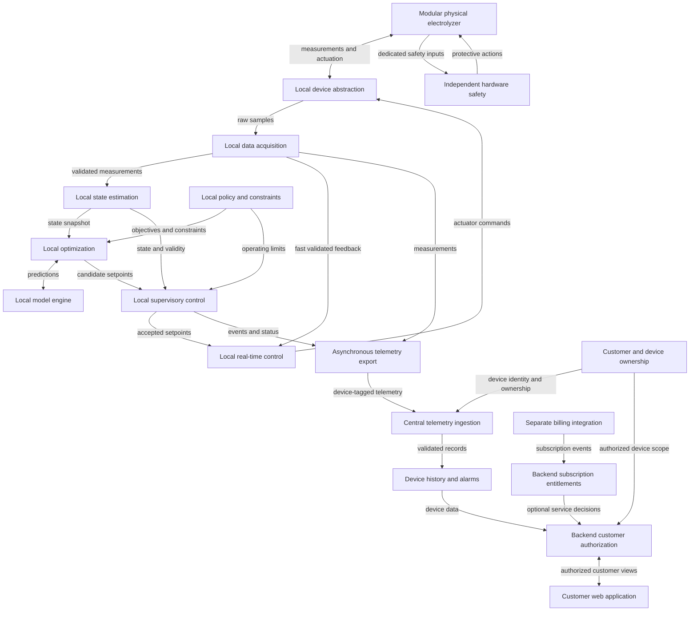
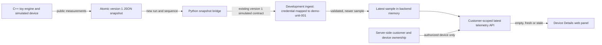
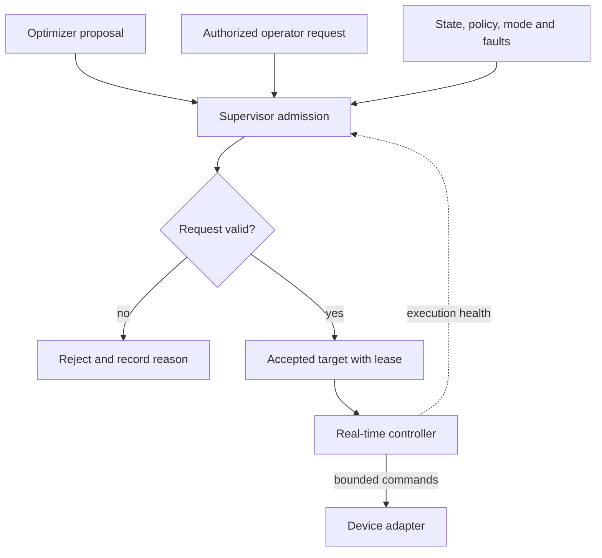
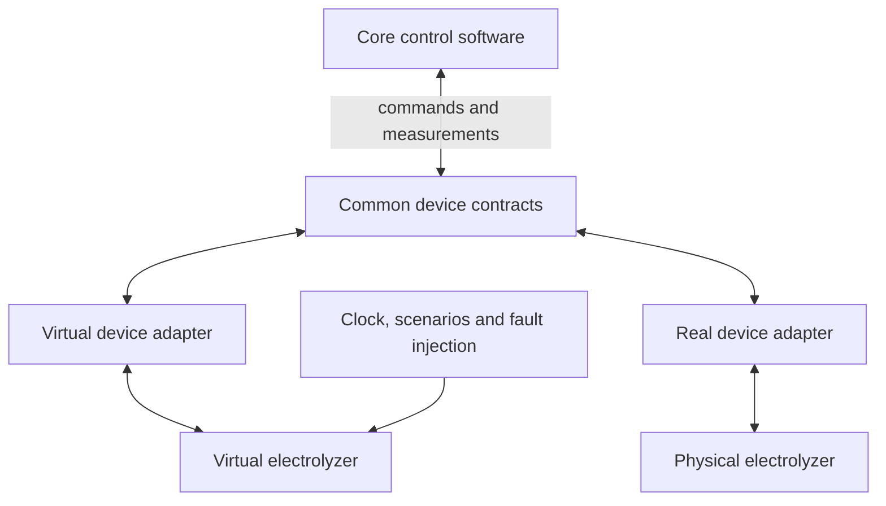

# Faradix Architecture — Version 0.1

| Field | Value |
| --- | --- |
| Product | Modular Faradix water-electrolyzer equipment, local control runtime, and customer web platform |
| Document version | 0.1 |
| Status | Proposed target architecture with an implemented C++ development engine, simulated device, snapshot bridge, and customer web shell |
| Prepared | 2026-10-27 |
| Implementation status | C++20 engine foundation and toy simulated device; atomic snapshot and Python bridge into the existing development telemetry API and web panel; no hardware integration |
| Basis | Supplied Faradix architecture context and the previously reviewed module-design draft |

This is a self-contained repository document. It preserves the supplied architectural principles and distinguishes them from proposed internal designs and unresolved engineering choices. Version 0.1 identifies this document, not a software release or a finalized industrial design.

See [README.md](README.md) for the project introduction and current repository scope.

## 1. Scope and product context

Faradix sells modular physical water-electrolyzer products to customers who may own multiple devices or installations. The product model connects physical equipment and independent hardware safety, a local C++ control runtime near the equipment, and a central customer web platform for remote monitoring and related services. Faradix also sells recurring software-service subscriptions. Subscription packaging, pricing, billing intervals, and payment providers are undecided.

The intended local software will continuously observe the plant, estimate its state, predict its behavior, apply operating policies, propose operating targets, and control the equipment. The customer web platform will manage device identity, ownership, authorized access, telemetry, history, alarms, and subscription-enabled services. It is not the location of the mandatory fast control loop.

The final sensor inventory, actuator inventory, I/O topology, communication protocols, physical equations, operating envelope, safety functions, and timing requirements are not yet known. Examples in this document are design concepts rather than finalized hardware specifications.

| Horizon | Scope |
| --- | --- |
| Current repository | Runnable C++ engine foundation, simulated device, snapshot bridge, and customer web shell; no physical telemetry, real authentication, billing, or subscriptions. |
| Next local-control milestone | Add state estimation, predictive modeling, policy, optimization proposals, and richer supervisory behavior around the existing toy device boundary. |
| Subsequent engineering | Integrate validated models, real device adapters, measured timing requirements, hardware-specific procedures, and the customer web platform. |
| Future capabilities | Advanced optimization, calibration workflows, additional customer services, external integration, digital-twin interoperability, and optional ML assistance. |

The present repository has `engine/`, `frontend/`, `backend/`, local dependencies, focused C++ and Python tests, and a simulated engine-to-panel telemetry path. It does not add a database, cloud deployment, physical telemetry, authentication, payment handling, or real hardware operation. Future capabilities listed here are not commitments to implement them immediately.

## 2. Architectural baseline

The following principles are retained from the project context:

1. **Independent hard safety.** Critical protective functions must be designed to remain effective despite failures of the main application, optimizer, model, operating system, network, database, interface, cloud connection, or billing service.
2. **Explicit command authority.** The optimizer proposes setpoints. Supervisory control decides whether they may be applied. Low-level control produces actuator commands. Operator requests, including any future remote requests, follow the same supervisory admission path.
3. **Separate scientific and operational responsibilities.** The model predicts behavior; policy specifies objectives and operating constraints; optimization selects a proposal; control executes accepted targets.
4. **Separate measurement from estimation.** DAQ reports validated observations and their quality. State estimation produces the best available estimate and its validity.
5. **Stable hardware interfaces.** Vendor-specific behavior belongs in adapters. Simulated and real devices expose compatible domain contracts.
6. **Independent execution rates.** Time-sensitive local control does not wait for an optimizer, UI, database, cloud platform, billing service, or entitlement check to respond. Cloud disconnection, subscription expiry, or billing outage must not disable independent safety or abruptly interrupt basic local control.
7. **Simple initial deployment.** Start with a modular core. A logical module does not automatically require a separate process or microservice.
8. **Traceable decisions.** Important commands, state transitions, model versions, policy versions, and configuration changes should be attributable to their inputs and context.
9. **Customer isolation and backend enforcement.** Each customer and user may access only authorized devices and data. The platform backend enforces feature entitlements; frontend visibility is not an authorization boundary.

These principles define the architecture's intended behavior. This document does not establish that any hardware, operating system, controller, or implementation already satisfies them.

## 3. Logical system architecture

The three system parts have distinct failure and authority boundaries. Physical equipment includes dedicated independent safety functions. Planned local software near each equipment installation owns the control loop. The target central platform will receive asynchronous telemetry and serve authorized customer web views; it does not host the mandatory fast loop. The diagram below shows the proposed equipment and platform target, not the limited implemented engine foundation.

The model and policy remain separate collaborators in local decision-making. The fast feedback path supplies low-level control independently of slower estimation, optimization, telemetry export, and the central platform. Telemetry carries stable device identity and is mapped to customer ownership before the backend exposes it to a customer's panel. A customer may have several devices grouped by installation when that concept is useful.

Telemetry export from future equipment software is intended to be asynchronous and bounded. Cloud or billing unavailability cannot stall local control. The development engine already steps independently of the bridge and backend; equipment export and qualified local control remain unimplemented. Any future remote-command path is separate from telemetry and requires backend authorization, a local admission interface, and local supervisory checks; no browser or billing service writes actuator commands.

For software-only development, a virtual electrolyzer replaces the physical plant behind the device interface. A simulated safety model can exercise software scenarios; it is distinct from the independent safety hardware required for the real plant.

### Implemented synthetic transport path

This development path has a deterministic toy plant and minimal command admission, but no equipment I/O, state estimator, predictive model, operating policy, optimizer, qualified real-time control, or physical safety function. The earlier standalone Python synthetic mode remains available for transport-only tests. `POST /api/v1/dev/telemetry` is disabled unless explicitly enabled and given an environment credential. The credential maps server-side to one demo device; the payload cannot assert customer ownership. The provisional envelope contains a version, device ID, timezone-aware measurement time, `simulated` source marker, and finite voltage (V), current (A), and temperature (°C) fields. Values are synthetic examples, not operating limits. The engine snapshot contains a run ID, sample sequence, simulation time, and original UTC measurement time. Its atomic file replacement and bounded Python bridge live outside the engine core. The bridge maps the snapshot to the server-owned demo device and keeps at most one pending sample; it never refreshes an unchanged snapshot. The backend latest sample survives only while its single process runs. Older or equal measurement times are rejected. `GET /api/v1/devices/{device_id}/telemetry` checks the current development customer and device ownership; it marks a sample stale after 15 seconds from its measurement time. The browser polls every 5 seconds by default without overlapping requests, retains stale readings, and shows backend unavailability separately from sample freshness. None of these states proves that physical hardware is connected. See [README.md](README.md) for setup and exact commands.

### Implemented engine foundation and limits

`faradix_core` advances fixed simulation steps and admits only finite dimensionless baseline drive requests from 0 to 1. `faradix_simulated_device` implements the replaceable `Device` interface; the engine sees only its public voltage, current, and temperature measurements, not hidden toy plant state. A rejected request is not applied and does not advance simulation time. `faradix_snapshot_adapter` writes complete versioned JSON to a temporary file and atomically replaces the latest snapshot. The C++ executable supports bounded steps or continuous wall-paced operation with signal-driven shutdown. It does not depend on Python, HTTP, backend availability, browser state, customer context, or subscription state. It makes no hard real-time guarantee.

The uncalibrated toy plant uses `I = 20u` A, `V = 40 + 0.5I + 0.01(T - 25)` V, and explicit Euler `T_next = T + dt × [0.002 I² - 0.08(T - 25)]` °C. Initial temperature is 25 °C. Here `u` is the admitted dimensionless drive and `dt` is the fixed simulation step in seconds. These coefficients and the software command range are development choices, **not validated equipment limits**. The toy plant is separate from the planned predictive physics model; it cannot establish physical accuracy. Simulation time advances only through admitted steps; UTC measurement time is captured from the wall clock for each exported sample. The Python bridge preserves that timestamp. Pending modules are state estimation, predictive modeling, operating policy, optimization proposals, full supervisory modes and fallback, real-time control, hardware I/O, and independent physical safety.

## 4. Module responsibilities and internal structure

### 4.1 Device abstraction layer

**Responsibility:** isolate vendor protocols, channel addressing, and device capabilities from the core.

**Proposed internals:** device registry, channel mapping, backend selection, protocol adapters, read/decode path, command validation/encoding, and device status reporting.

**Inputs and outputs:** receive raw device I/O and `ControlCommand` requests; emit sample envelopes, communication status, dispatch results, and readback when supported.

Timeouts and communication errors must remain explicit. Successful transmission is not proof that an actuator physically reached its requested state. Independent safety actions do not pass through this application abstraction.

**Implemented foundation:** the C++ `Device` interface exposes `measure()` and `advance(step_seconds, AdmittedCommand)`; only `SimulatedDevice` implements it. No hardware protocol or actuator adapter exists.

### 4.2 Data acquisition

**Responsibility:** turn incoming samples into usable measurements with units, time, identity, and quality.

**Proposed internals:** acquisition scheduling, timestamp/sequence handling, unit normalization, signal mapping, basic plausibility checks, freshness checks, and bounded feedback snapshots.

**Inputs and outputs:** raw sample envelopes become `Measurement` batches. Relevant validated signals feed real-time control; richer batches feed state estimation and asynchronous recording.

Missing, invalid, or stale values are marked accordingly. A previous value must not silently become a fresh valid measurement. Filtering must preserve the latency requirements of each consumer.

### 4.3 State estimation

**Responsibility:** estimate the plant state from imperfect measurements.

**Proposed internals:** bounded time alignment, input-quality gating, filtering, derived signals, optional observers, residual checks, and confidence assessment.

**Inputs and outputs:** measurements and approved estimator parameters produce a `SystemState` snapshot with provenance and validity. Measured and estimated quantities remain distinguishable.

Insufficient observations produce an explicit degraded or invalid estimate. The supervisor, rather than the estimator, decides the operating response. Advanced estimators are optional future additions.

### 4.4 Electrolyzer model engine

**Responsibility:** predict behavior for a given state and candidate operating condition.

**Proposed internals:** request validation, a versioned parameter bundle, coupled model evaluation, and derived performance calculations. Potential submodels cover electrochemistry, electrical behavior, thermal behavior, fluids, gases, production, efficiency, and degradation.

**Inputs and outputs:** state, candidate conditions, and prediction horizon produce `Prediction` values with a model version and validity status.

Only available and validated submodels are enabled. Out-of-domain requests, unsupported outputs, or solver failures are reported explicitly. The model does not issue device commands or encode the operator's objectives.

### 4.5 Policy and constraints engine

**Responsibility:** express what operation is permitted and which objectives are preferred.

**Proposed internals:** mode rules, policy configuration, approved operating-envelope references, priority resolution, consistency checks, and hard/soft constraint classification.

**Inputs and outputs:** operating context and versioned policy produce an objective specification and `ConstraintSet` for the optimizer and supervisor.

Physical and mandatory operating limits cannot be traded away for a better objective. Soft constraints and preferences operate within the permitted envelope. Conflicting policies are rejected. Application policy configuration does not configure or disable independent hard safety.

### 4.6 Optimization engine

**Responsibility:** propose a desirable feasible operating point.

**Proposed internals:** periodic/event triggering, consistent input snapshots, a bounded solve job, a replaceable algorithm, calls to the model interface, feasibility checks, and result packaging.

**Inputs and outputs:** `SystemState`, objectives, constraints, and a fixed model version produce `OptimizationResult`: a candidate or failure status, input references, and an expiry.

Timeout, infeasibility, and invalid predictions are normal explicit outcomes. The optimizer never writes to actuators. Start with a simple rule-based or numerical approach; MPC and ML assistance remain later choices.

### 4.7 Supervisory control

**Responsibility:** own operational transitions and the admission of requested targets.

**Proposed internals:** command-source arbitration, lifecycle state machine, state/quality checks, setpoint freshness checks, constraint checks, rate limiting, handover handling, and approved fallback selection.

**Inputs and outputs:** optimizer proposals or authorized operator requests, together with state, policy, faults, and safety status, produce `AcceptedSetpoint` or a rejection with a reason.

Manual mode does not bypass restrictions. Clamping or shaping a proposal requires rechecking relevant coupled constraints. Holding the last target is permitted only when its validity and the operating procedure allow it.

**Implemented foundation:** the engine admits finite toy drive requests within 0–1 before invoking the simulated device. This is only a baseline admission check, not the proposed full supervisor, lifecycle, or hardware operating policy.

### 4.8 Real-time control

**Responsibility:** drive the equipment toward the accepted target using bounded control work.

**Proposed internals:** feedback snapshots, a target mailbox, freshness/lease checks, controller algorithms, actuator output limits, anti-windup where applicable, command sequencing, and cycle-health monitoring.

**Inputs and outputs:** validated feedback and `AcceptedSetpoint` produce `ControlCommand` and execution status. PID, feed-forward, and other controllers are candidates, not universal requirements.

This path excludes blocking optimization, database access, remote API calls, and unbounded work. Expired targets, stale feedback, and missed deadlines invoke defined local behavior and notify the supervisor. Hardware-specific fallback actions remain to be designed.

### 4.9 Independent safety layer

**Responsibility:** enforce critical protective functions independently of the application.

**Conceptual structure:** safety inputs and emergency-stop/interlock signals feed independent safety logic, which controls protective outputs and final elements. Main software may observe status; ordinary commands must not defeat protective action.

The exact controller, sensor arrangement, trip conditions, reset conditions, safe states, failure coverage, and integrity requirements depend on the hardware safety design. Operator-interface acknowledgement is distinct from safety reset and restart authorization.

This subsection defines a boundary. It is not a safety implementation, certification, or complete hazard analysis.

### 4.10 Virtual electrolyzer

**Responsibility:** support closed-loop software development before final hardware is available.

**Proposed internals:** simulation clock, scenario configuration, actuator dynamics, plant dynamics, sensor behavior, fault injection, and recording/replay.

**Inputs and outputs:** the same domain command and measurement contracts used by real adapters. Initial equations may be simple; simulated plant state and externally observed sensor values are separate.

The simulation plant and the optimizer's prediction model have different roles. Parameter mismatch, noise, delays, and failures must be testable. Simulated safety behavior is a test aid, not a substitute for independent real hardware protection.

### 4.11 Data management and logging

**Responsibility:** retain operational evidence for investigation, analysis, and model improvement.

**Proposed internals:** bounded asynchronous queues, background writers, event/measurement storage, version references, query/export, and retention policies.

Records include measurements, states, proposals, accepted targets, commands, alarms, and configuration changes. Decisions should reference the state, model, policy, and configuration that produced them.

Storage failure must not block the control cycle. Queue overflow policy and loss counters must be explicit. If an operating mode requires uninterrupted audit recording, the supervisory response to recording loss must be separately defined.

### 4.12 Diagnostics and fault management

**Responsibility:** turn software/device health evidence into actionable faults and alarms.

**Proposed internals:** diagnostic rules, persistence checks, severity classification, deduplication, alarm lifecycle management, and contextual event records.

Inputs include measurement quality, device status, timing health, and model residuals where available. Outputs go to the supervisor, local operator interface, and event history. Acknowledging an alarm does not clear its cause or reset a safety trip. General application diagnostics do not replace independent safety functions.

### 4.13 Configuration and versioning

**Responsibility:** validate and activate compatible configuration snapshots in a controlled manner.

**Proposed internals:** schema/unit/range validation, compatibility checks, version storage, staging, permitted activation boundaries, and change history.

Device maps, runtime settings, policies, and model parameters are configuration domains. Related versions must be coherent. A running solve uses a fixed input/version snapshot; the control cycle does not parse configuration files.

Invalid changes are rejected. Rollback also requires compatibility and operating-state checks. Independent safety configuration remains outside this general application workflow.

### 4.14 Model calibration

**Responsibility:** propose improved model parameters from experimental or operational evidence.

**Proposed internals:** data selection and quality checks, calibration/validation separation, offline fitting, model evaluation, validation reports, engineering review, and version registration.

The output is a candidate parameter/model bundle with a validity domain and supporting evidence. It reaches runtime only through the configuration activation workflow. Automatic online adaptation is a future capability with additional requirements.

### 4.15 Local operator interface and control API

**Responsibility:** expose local monitoring and, where required, authorized operational requests without bypassing supervisory control.

**Proposed internals:** local status and alarm views or an application API, request authorization, command admission into the supervisor, and request status tracking. The form of a local operator interface is unresolved; a Qt desktop application is not an agreed requirement.

Reads use local snapshots or history. Commands carry identity and request IDs; handling must define deduplication and distinguish received, accepted, rejected, and applied states. A request ID alone does not guarantee exactly-once execution.

Interface loss must not make the fast control loop wait. No interface has a direct actuator-writing path or may bypass supervisory or safety restrictions.

### 4.16 Telemetry export and external integrations

**Responsibility:** send device-tagged telemetry, events, and health status to the central platform without coupling local control to connectivity.

**Proposed internals:** bounded asynchronous export, device identity, timestamps and sequence references, reconnect behavior, delivery status, and explicit data-loss reporting. Optional SCADA, energy-system, and remote-analytics adapters use similarly bounded interfaces.

The central platform may be unavailable while local control continues. The C++ snapshot adapter and Python development bridge demonstrate that the toy engine can continue when the bridge or backend stops; they do not implement production equipment export. Transport, buffering limits, delivery guarantees, and reconciliation behavior for actual equipment remain design decisions. Telemetry export does not act as a command channel. Industrial protocols and other external integrations are outside the first local simulated-loop target unless a concrete requirement makes them necessary.

### 4.17 Central customer web platform

**Responsibility:** manage customer-visible devices and installations, receive telemetry, retain history and alarms, and serve authorized monitoring and subscription-enabled services through a web application.

**Proposed internals:** telemetry ingestion, device registry, customer-scoped data storage, alarm and history queries, backend access checks, feature-entitlement checks, and a customer web API.

**Implemented development path:** `frontend/` uses React, TypeScript, and Vite for Overview, My Devices, Device Details, and Subscription. `backend/` uses FastAPI for health, fixture customer and device records, subscription status, latest customer-scoped telemetry reads, and disabled-by-default development ingestion. A Python bridge sends new C++ engine snapshots for one existing demo device; its older synthetic mode remains an independent transport demo. The backend keeps only the newest sample in process memory; Device Details polls and labels empty, fresh, stale, and backend-unavailable states. History, alarms, persistent storage, operational commands, real equipment integration, and subscriptions remain unimplemented.

The target platform must associate incoming telemetry with authenticated device identity and current customer ownership before exposing it. The development path instead uses an environment-provided bearer credential mapped server-side to one fixture device, plus the existing server-side customer dependency and ownership check on reads. This is not production authentication. The platform is not responsible for the mandatory fast control loop. Possible paid services include extended history, analytics, reports, or remote support; these are examples, not committed subscription-plan contents.

### 4.18 Customer, user, and device ownership

**Responsibility:** represent customer or tenant accounts, user access, device identity, device ownership, and optional installation or device-group membership.

**Proposed internals:** stable device identifiers, enrollment and ownership records, customer/user roles or permissions, installation/group associations, and audited reassignment. A customer may own multiple devices; one device's data and actions must not leak to another customer.

Every platform read and action must resolve the user's authority over the referenced device and data. Group membership is useful for navigation and aggregation but cannot replace device-level ownership checks. The exact tenancy and role model remains open.

**Implemented development boundary:** a single replaceable FastAPI dependency selects `demo-customer-01` on the server. Fixtures contain two customers and devices for both; list, detail, and latest-telemetry routes return only the selected customer's devices, using the same `404` for unknown and other-customer IDs. Browser-supplied customer IDs do not confer authority. The development publisher credential permits only `demo-unit-001`, regardless of submitted ownership claims. This is fixture scoping, not authentication or a production tenant-security design. The shell is not ready for public deployment.

### 4.19 Subscription plans and feature entitlements

**Responsibility:** represent subscription state and decide which optional platform services a customer may use.

**Proposed internals:** plan definitions, customer subscriptions, effective entitlement evaluation, lifecycle state, and an auditable backend decision record. The backend enforces entitlements; hiding frontend controls alone is insufficient.

The included feature set, paid feature set, charging basis, grace-period behavior, and relationship between entitlements and optimization capabilities are undecided. Entitlement checks stay outside the time-critical local control path. Expiry must not disable independent hardware safety or abruptly interrupt basic local control; treatment of optional remote services requires a defined lifecycle policy.

**Implemented shell:** `/api/v1/subscription` returns `not_configured`. There are no plan records, active subscriptions, feature-entitlement rules, or expiry behavior.

### 4.20 Billing integration

**Responsibility:** exchange subscription and payment state with a billing provider while keeping commercial transactions separate from device operation and entitlement policy.

**Proposed internals:** provider adapter, event reconciliation, idempotent state updates, and failure reporting. Payment provider, currencies, pricing, and billing intervals have not been chosen.

A billing outage must not become a control-loop dependency. The subscription lifecycle must define how stale or missing billing events affect optional services, including offline and grace periods, without impairing independent safety or basic local control. No billing adapter or payment flow is implemented in the shell.

## 5. Shared domain contracts

The following are proposed conceptual target contracts, not finalized C++, database, or Protocol Buffers schemas. Serialization, identifiers, precision, units, and compatibility rules remain design tasks. The current C++ foundation defines `Measurements`, `DeviceState`, `RequestedCommand`, `AdmittedCommand`, and a replaceable `Device` interface. Its development JSON snapshot is version 1 and distinct from the existing FastAPI version 1 simulated telemetry ingest contract. The Python bridge validates and maps between them. These small contracts do not implement the target equipment domain contracts.

| Contract | Minimum information | Key meaning |
| --- | --- | --- |
| `Measurement` | Signal/source identity, value, unit, source time, receive time, sequence, quality | An observation with explicit freshness and validity. |
| `SystemState` | Snapshot ID, time, values, validity, confidence, source references | A coherent estimated state; measured and inferred quantities are distinguishable. |
| `Prediction` | Request ID, horizon, outputs, model version, validity | A model result, not an actuator command. |
| `ConstraintSet` | Policy version, mode, mandatory bounds, soft terms, rate limits | Application operating restrictions and preferences. |
| `OptimizationResult` | Job ID, candidate if any, solve status, input/version references, expiry | A proposal or explicit failure. |
| `AcceptedSetpoint` | Request/source identity, targets, mode, sequence, lease, constraint reference | A supervisor-approved target with bounded validity. |
| `ControlCommand` | Device/channel, requested value and unit, sequence, deadline | A low-level request whose dispatch and observed result are tracked separately. |
| `Fault` / `Event` | Identity, source, severity, time, lifecycle status, context references | A diagnosable condition or operational event. |
| `ModelBundle` | Code version, parameter version, validity domain, validation reference | A compatible model configuration. |
| `ConfigSnapshot` | Version, compatible dependencies, activation record, author/reason | An immutable active configuration and its history. |
| `DeviceIdentity` | Stable ID, enrollment state, ownership reference, installation/group references | Associates equipment telemetry with the correct customer. |
| `TelemetryEnvelope` | Device ID, source time, sequence, quality, measurement/event references | Asynchronous data for central ingestion, distinct from a control request. |
| `CustomerAccess` | Tenant/customer ID, user ID, role or permissions, device scope | Backend authorization for customer data and actions. |
| `FeatureEntitlement` | Customer/subscription reference, feature key, effective state and validity | Backend decision for an optional service, not a time-critical safety or control input. |

Source timestamps, receipt timestamps, simulation time, and deadline clocks serve different purposes. Define their clock domains explicitly. Local elapsed-time checks should use an appropriate monotonic time base; cross-device timestamps require a synchronization policy rather than direct comparison by assumption.

## 6. Command and decision flow

Acceptance evaluates source authority, current mode, data quality, proposal age, operating limits, and transition restrictions. The real-time layer independently checks the accepted target's lease and its own feedback quality.

Authority priority between local manual operation, automatic optimization, and any future remote requests is unresolved. There must be an explicit active command owner and a defined handover; simultaneous writers are not an acceptable implicit policy.

Remote operational commands are not a committed product feature. If offered later, their path must be separate from telemetry: customer web request → central backend authentication, device authorization, and applicable feature-entitlement check → protected local command interface → local supervisor admission → real-time control → device adapter. The browser and billing service never command actuators directly. A central acceptance response is not proof of local application, and lost connectivity must leave the local runtime in its defined operating mode.

## 7. Runtime, lifecycle, and failure behavior

### 7.1 Proposed execution arrangement

A reasonable future starting point is a modular local C++ runtime near the equipment, with separate execution paths for fast I/O/control, state/supervisory work, and bounded optimization jobs. Supporting local API, storage, and telemetry-export work remains outside the control cycle. The central customer web platform is a separate system, not the location of the mandatory fast loop. Module calls within a local process do not need network RPC. The current repository runs a standalone C++ toy engine and separate local-only Vite and FastAPI development servers, both servers bound to `127.0.0.1`.

Use coherent snapshots, bounded queues, and a target mailbox with explicit ownership and synchronization. A thread separation alone does not isolate process crashes, memory corruption, resource exhaustion, or all scheduling interference. Consider a separate worker process when Python integration, blocking libraries, or fault-isolation requirements justify it.

Control, supervisory, and optimization periods may differ. Numeric periods, deadlines, worst-case execution budgets, jitter limits, queue capacities, and scheduling policy are **TBD**. C++ or a real-time kernel alone does not establish deterministic behavior.

### 7.2 Lifecycle and optimization objectives

Separate plant lifecycle from optimization strategy. A proposed lifecycle may include `OFF`, `STARTUP`, `RUNNING`, `STANDBY`, `SHUTDOWN`, `MAINTENANCE`, and `FAULT`. Strategies such as maximum efficiency or low degradation can apply within permitted lifecycle states.

Final state names, transition guards, recovery conditions, and startup/shutdown sequences require hardware input. They are not executable procedures in this document.

### 7.3 Failure ownership

| Condition | Detection/reporting | Intended response boundary |
| --- | --- | --- |
| Missing, stale, or invalid measurement | DAQ; local freshness checks | Mark quality; RT and supervisor apply their defined policies. |
| Low-confidence or invalid estimate | State estimation | Supervisor evaluates whether continued operation is permitted. |
| Out-of-domain or failed prediction | Model engine | Reject the prediction and report optimization failure if needed. |
| Optimization timeout or infeasibility | Optimization worker | Publish failure; supervisor selects an approved operating response. |
| Expired accepted target | Real-time control | Invoke defined local fallback and report status. |
| I/O failure or control deadline miss | Device/runtime monitoring | Execute hardware-specific local behavior and notify supervisory control. |
| Database unavailable or queue full | Background writer/queue monitoring | Keep control non-blocking; report loss/degradation and apply the defined audit policy. |
| UI, API, or cloud unavailable | Application/integration monitoring | Continue basic local control subject to its operational authority policy; report delayed telemetry and remote-service degradation. |
| Subscription expired or billing/entitlement service unavailable | Central subscription and billing monitoring | Apply the defined policy to optional platform services; never disable independent safety or abruptly interrupt basic local control. |
| Main application or OS failure | Independent hardware mechanisms | Hardware safety and device failure behavior must cover the relevant scenarios. |
| Safety trip | Independent safety layer | Protective action has priority; restart follows separately defined conditions. |

Holding the last output, forcing zero output, or stopping immediately is not a universal safe response. Fallback and safe-state definitions depend on the plant and must be established before real operation.

## 8. Simulation and planned validation

The architecture target is to change device bindings without rewriting the core's domain logic. Real integration will still require appropriate configuration, capability mapping, timing validation, and hardware-specific behavior.

The next planned local-control milestone will demonstrate:

- Extend the implemented toy command/measurement loop with state estimation and a separate predictive model.
- Add distinct policy objectives, optimizer proposals, supervisor-accepted targets, and eventual actuator commands.
- Enforcement of declared application limits and target validity.
- Explicit responses to stale data, invalid estimates, optimization failure, and simulated device faults.
- Continued bounded control when non-critical consumers are slow or unavailable.
- Sufficient event and version context to investigate a decision or transition.

These are remaining local-control acceptance goals beyond the tested foundation, not claims of completed behavior. Use repeatable scenarios and varied plant/model parameters; a successful loop using identical models is not evidence of physical accuracy or hardware safety. Current C++ tests cover deterministic stepping, command admission and device calls, and bounded execution. Python tests cover fixture ownership scoping, synthetic ingestion, device restriction, sample validation and ordering, freshness, snapshot deduplication, timestamp preservation, restart recognition, and bounded retries. Later platform validation must test real authentication, customer data isolation, device ownership mapping, backend entitlements, and local control during cloud or billing outages.

## 9. Configuration and decision traceability

Keep model code, calibrated parameters, operating policies, and device bindings separately identifiable. Validate their compatibility before activating a coherent snapshot at a permitted boundary.

For an important decision, retain enough context to identify the relevant state snapshot, active lifecycle/authority, model and policy versions, candidate, admission outcome, accepted target, dispatch outcome, and available readback. Define recording rates and retention according to data volume and investigation needs.

A model calibration workflow produces a reviewed candidate bundle. A configuration workflow activates it. Neither an offline fitting script nor a local or web interface directly mutates a live controller's internal parameters during a cycle.

## 10. Provisional technology direction

C++20 and CMake are implemented for the development engine; FastAPI, React, TypeScript, and Vite are implemented for the customer shell. Other entries remain candidates for later equipment and platform work, not installed dependencies or finalized requirements.

| Area | Current direction | Decision still needed |
| --- | --- | --- |
| Core and simulated adapter | C++20 engine foundation implemented with GCC 11 and CMake 3.22 | Production toolchain, hardware adapters, estimation, model, policy, optimization, and timing constraints. |
| Research, fitting, offline analysis | Python | Boundary between experimental and deployed components. |
| Optimization | Simple initial approach; CasADi and acados/generated code as future candidates | Problem formulation, solver budget, licensing and deployment fit. |
| Central platform API | FastAPI implemented for the local fixture API | Real authentication, authorization model, persistence, and production API boundaries. |
| Customer web application | React, TypeScript, and Vite implemented for the development shell | Production hosting, customer workflows, and integration; Qt desktop is not an agreed requirement. |
| Storage | PostgreSQL; optional time-series extension or partitioning | Ingestion volume, retention, and query requirements. |
| Cross-process API | gRPC and Protocol Buffers where needed | Whether an RPC boundary is justified for each connection. |
| Field/industrial communication | EtherCAT, Modbus, CAN, OPC UA or vendor interfaces | Actual devices, topology, and timing requirements. |
| Remote telemetry | MQTT where justified | Device identity, delivery, buffering, and connectivity requirements. |
| Subscription and billing services | No provider or implementation selected | Plan contents, charging basis, lifecycle policy, payment provider, currencies, and billing intervals. |
| Edge execution | Linux; possible PREEMPT_RT | Measured timing needs and deployment qualification. |
| Safety | Independent safety controller/PLC or equivalent design | Hardware hazard analysis and protective-function requirements. |
| Build and validation | CMake/CTest for the engine; Vite build and pytest for the platform | Equipment validation scope, hardware tests, and any future test-framework choice. |
| Deployment | Native control runtime; containers considered for supporting services | Isolation and operational requirements. |

C++20, CMake, CTest, FastAPI, React, TypeScript, Vite, and focused test dependencies are selected by the current development implementation. Other entries remain provisional. A service mesh, Kubernetes deployment, distributed microservices, advanced ML, and a full digital twin are not initial architectural requirements.

## 11. Open decisions

| Topic | Required clarification |
| --- | --- |
| Hardware and I/O | Sensor/actuator inventory, channel semantics, device capabilities, protocols, readback, and command-loss behavior. |
| Physical model | Available equations and parameters, state variables, coupling, prediction horizon, uncertainty, and validity domains. |
| Operating envelope | Hardware-supported ranges, application limits, rate limits, and permitted combinations. |
| Timing | Control/estimation/optimization periods, deadlines, jitter, synchronization, and freshness thresholds. |
| Control placement | Which loops run in the edge runtime, equipment controllers, or PLCs. |
| Lifecycle and authority | State transitions, manual/automatic ownership, remote control permissions, startup, shutdown, and recovery. |
| Fallback and safety | Situation-specific fallback, protective actions, reset conditions, and independent hardware coverage. |
| Optimization | Decision variables, objectives, feasibility criteria, priorities, and solver failure policy. |
| Data and observability | Rates, precision, queue sizes, retention, audit requirements, and acceptable data loss. |
| Included and subscription features | Which services are included, which are paid, and whether any optimization capability is subscription-dependent. |
| Charging basis | Per customer, installation, device, or another basis. |
| Subscription lifecycle | Activation, renewal, expiry, cancellation, offline behavior, and grace-period rules for optional services. |
| Historical data after expiry | Continued access, export, and retention when a subscription expires. |
| Remote operational commands | Whether they will be offered; if so, authority, local admission, loss-of-connection behavior, and audit rules. |
| Payments | Pricing, payment provider, supported currencies, and billing intervals. |
| Deployment | Actual process boundaries, resources, service dependencies, and target platform. |

These are decisions to resolve with relevant software, hardware, and modeling contributors. Unknown values must remain explicitly unknown rather than being filled with arbitrary operating numbers.

## 12. Incremental documentation workflow

Keep `README.md` and this architecture document synchronized with the implemented engine foundation, development telemetry bridge, customer shell, and later architectural decisions. The README gives exact local setup and startup commands; this document separates current fixture behavior from the proposed physical, local-control, and central-platform target.

The C++ engine and telemetry bridge demonstrate a software-only toy plant, local stepping, and transport into the web panel. They do not imply implementation progress in independent hardware safety, qualified local control, physical telemetry integration, production authentication, entitlements, or billing. Future revisions should update responsibilities, interfaces, assumptions, and open decisions as those capabilities are specified and built. Branch names, remotes, repository visibility, licensing, and push timing remain repository-management decisions outside this architectural baseline.
