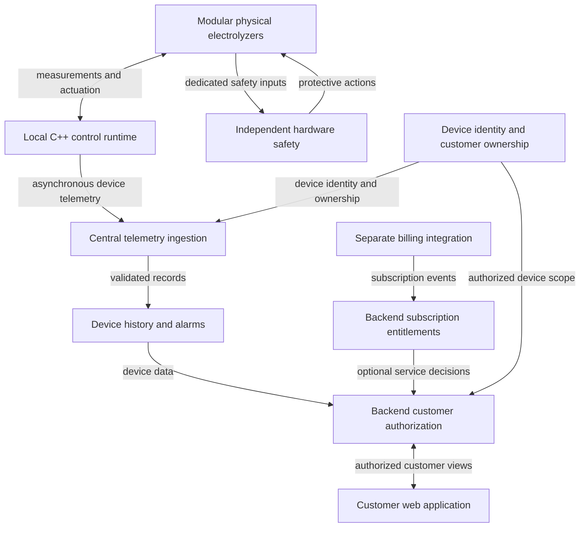

# Faradix Modular Electrolyzer Products and Software Platform

Faradix sells modular physical water-electrolyzer products with local control software and a customer-facing web platform. Customers may own multiple devices or installations. Faradix also sells recurring software-service subscriptions; plan contents, pricing, billing intervals, and payment providers are undecided.

- **Project stage:** architecture and system design.
- **Current repository state:** documentation only; no equipment-control runtime, web platform, simulator, or billing implementation is present.
- **Architecture document version:** 0.1, proposed. This is a document version, not a software release.

## Purpose and system boundaries

The proposed system has three connected parts:

1. **Physical equipment and independent hardware safety:** modular electrolyzer devices, their sensors and actuators, and protective functions that remain effective independently of application software.
2. **Local C++ control runtime near the equipment:** device access, acquisition, state estimation, modeling, policy, optimization, supervisory admission, and time-sensitive control. C++ is the current core-runtime direction; the implementation and hardware details remain to be decided.
3. **Central customer web platform:** device and installation management, remote monitoring, history, alarms, customer/user access, and subscription-enabled services. A web application is the current customer-interface direction; a Qt desktop application is not an agreed requirement.

The electrolyzer hardware is still under development. Sensor types, actuators, communication protocols, operating ranges, control periods, and the detailed physics model have not been finalized.

## Architecture overview

Telemetry is associated with device identity and customer ownership before it appears in the appropriate customer's web panel. The diagram shows monitoring, not remote control. Whether remote operational commands will be offered is unresolved; any future command path must use backend authorization and local supervisory admission, with no direct browser or billing-service access to actuators.

## Design principles

- Keep hard safety independent of the main application, cloud platform, and billing services.
- Keep basic local control operating through cloud disconnection. Subscription expiry or a billing outage must not disable independent safety or abruptly interrupt basic local control.
- Route optimizer proposals and operator requests through supervisory control; neither directly controls actuators.
- Separate device access, data acquisition, state estimation, modeling, policy, optimization, and control.
- Use compatible contracts for simulated devices and real hardware adapters.
- Keep time-sensitive control independent of blocking database, UI, cloud, billing, entitlement, and optimization work.
- Restrict each customer and user to authorized devices and data. The platform backend enforces subscription entitlements; hiding web controls alone is insufficient.
- Begin with a modular local core and a simulated closed loop. Add deployment complexity when a concrete requirement justifies it.

## Customer services and open product decisions

The central platform is intended to associate devices with customers and, where useful, installations or device groups. It will manage user access, telemetry, history, alarms, and subscription entitlements. Billing integration supports subscription records but stays separate from the time-critical equipment-control path.

Extended history, analytics, reports, and remote support are examples of possible paid services, not committed plan contents. It is undecided which features are included, how subscriptions are charged, what happens during expiry or offline periods, how historical data remains accessible after expiry, whether remote commands are offered, and which payment providers, currencies, and billing intervals to use. Optimization capabilities have not been assigned to any subscription tier.

## Current scope

This repository currently contains only these two documentation files:

| File | Purpose |
| --- | --- |
| [README.md](README.md) | Product model, current state, system boundaries, and entry point. |
| [ARCHITECTURE_v0.1.md](ARCHITECTURE_v0.1.md) | Proposed boundaries, contracts, runtime behavior, customer platform concepts, and open decisions. |

This documentation milestone does not add application code, build configuration, dependencies, CI/CD, deployment configuration, or a working simulator. Build and execution instructions will be documented when an implementation exists.

## First planned implementation milestone

After the necessary design decisions are reviewed, the first implementation target is an end-to-end simulated local loop: virtual measurements, basic state estimation, a simple model and policy, a simple optimizer, supervisory acceptance, control commands, and simulated plant response.

Its purpose is to validate the local architecture and failure behavior. It will not establish production readiness, physical model accuracy, hardware safety certification, or a delivered customer web platform.

## Technology direction

C++ is the current preference for the local core runtime; Python is a candidate for research and offline tooling. The customer interface direction is a web application. Backend framework, frontend framework, storage, industrial protocols, telemetry transport, and optimization libraries remain provisional choices. See the [technology section](ARCHITECTURE_v0.1.md#10-provisional-technology-direction) for current candidates.

## Incremental development

Keep the README and architecture document consistent as responsibilities, interfaces, assumptions, and open decisions change. Distinguish planned functionality from implemented behavior. Implementation is a separate milestone and should begin only when explicitly requested. No repository visibility, licensing, or publishing decision is implied by these documents.
