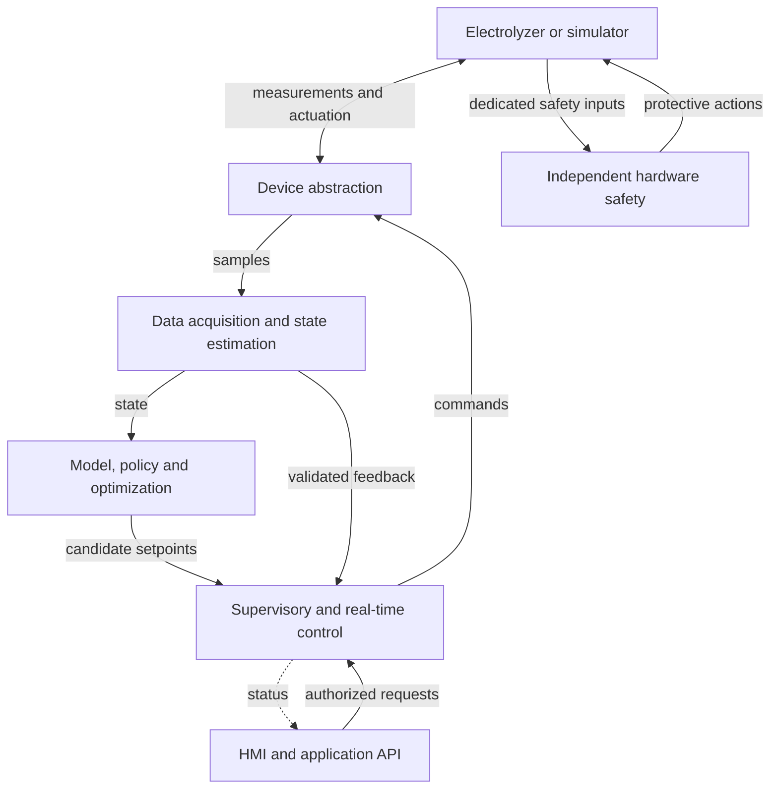

# Faradix Electrolyzer Control & Optimization Platform

A proposed software platform for monitoring, modeling, optimizing, and controlling a water electrolyzer for hydrogen production.

**Project stage:** architecture and system design.  
**Current milestone:** documentation baseline.  
**Architecture document version:** 0.1, proposed. This is not a software release.

## Purpose

Faradix is designing a closed-loop platform that will acquire sensor measurements, estimate the electrolyzer's state, predict its behavior, evaluate operating policies, propose suitable setpoints, and control the equipment through hardware-independent interfaces.

The electrolyzer hardware is still under development. Sensor types, actuators, communication protocols, operating ranges, control periods, and the detailed physics model have not been finalized. The architecture must accommodate these decisions as they become available.

## Architecture overview

Related modules are grouped in this overview. The architecture document separates their responsibilities. The independent hardware safety path applies to the real plant; a simulator may emulate safety behavior for testing.

## Design principles

- Keep hard safety independent of the main application and optimization software.
- Route optimizer proposals and operator requests through supervisory control; neither directly controls actuators.
- Separate device access, data acquisition, state estimation, modeling, policy, optimization, and control.
- Use compatible contracts for simulated devices and real hardware adapters.
- Keep time-sensitive control independent of blocking database, UI, cloud, and optimization work.
- Begin with a modular core and a simulated closed loop. Add deployment complexity only when a concrete requirement justifies it.

## Current scope

The current deliverable consists of these two documentation files, placed together in the repository root:

| File | Purpose |
| --- | --- |
| [README.md](README.md) | Project purpose, current scope, and entry point. |
| [ARCHITECTURE_v0.1.md](ARCHITECTURE_v0.1.md) | Proposed boundaries, diagrams, contracts, runtime behavior, and open decisions. |

This documentation milestone does not add application code, build configuration, dependencies, CI/CD, deployment configuration, or a working simulator. Build and execution instructions will be documented when an implementation exists.

## First planned implementation milestone

After the necessary design decisions are reviewed, the first implementation target is an end-to-end simulated loop: virtual measurements, basic state estimation, a simple model and policy, a simple optimizer, supervisory acceptance, control commands, and simulated plant response.

Its purpose is to validate the architecture and failure behavior. It will not establish production readiness, physical model accuracy, or hardware safety certification.

## Technology direction

C++ is the current preference for the core runtime; Python is a candidate for research and offline tooling. API, HMI, storage, industrial protocols, and optimization libraries remain provisional choices. See the [technology section](ARCHITECTURE_v0.1.md#10-provisional-technology-direction) for the current candidates.

## Incremental development

Start by reviewing and committing this documentation baseline. Subsequent commits should capture meaningful changes to responsibilities, interfaces, assumptions, or unresolved decisions. Keep the README consistent with the architecture and distinguish proposed functionality from implemented behavior.

Implementation is a separate milestone and should begin only when explicitly requested. No repository visibility, licensing, or publishing decision is implied by these documents.
